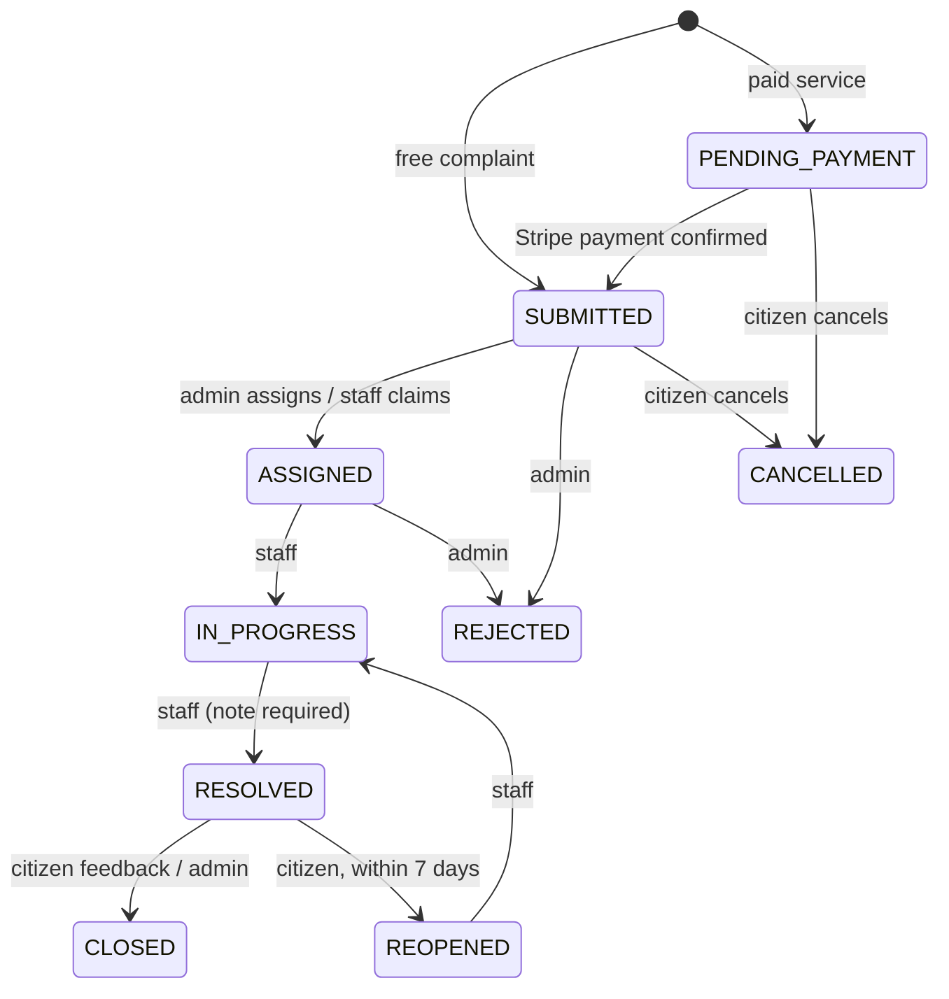
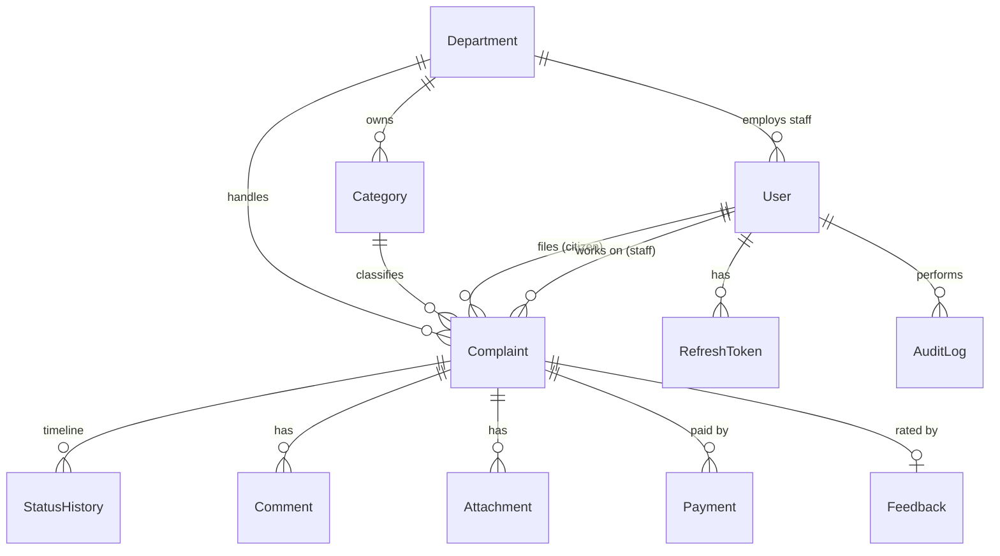

# CityFix API — City Complaint & Service Request Platform

A backend-only REST API where citizens report civic problems (potholes, broken street lights, missed garbage pickup)
and apply for paid municipal services (trade licence, bulk waste pickup, new water connection). Each request is
routed to the responsible department, assigned to staff, tracked against an SLA deadline, and closed with citizen
feedback.

**Stack:** Node.js · TypeScript · Express 5 · PostgreSQL · Prisma · Zod · JWT · Google OAuth · Stripe · Redis ·
Multer + Cloudinary · tsup · Vercel

## Submission

```
Project Name    : CityFix - City Complaint & Service Request Platform
Backend Repo    : <your GitHub repository URL>
Live API        : <your deployed URL>
API Docs        : <your published Postman documentation URL>
Demo Video      : <your video URL>
Admin Email     : admin@cityfix.com
Admin Password  : Admin@12345
```

Other seeded demo accounts (password `Demo@12345`):

| Role    | Email                     | Department             |
| ------- | ------------------------- | ---------------------- |
| STAFF   | `staff.roads@cityfix.com` | Roads & Infrastructure |
| STAFF   | `staff.waste@cityfix.com` | Waste Management       |
| STAFF   | `staff.water@cityfix.com` | Water & Sewerage       |
| CITIZEN | `citizen@cityfix.com`     | —                      |

## Roles

| Role        | Can do                                                                                                                                        |
| ----------- | --------------------------------------------------------------------------------------------------------------------------------------------- |
| **CITIZEN** | File, edit, cancel and delete own requests · pay service fees · comment · reopen within 7 days · give feedback                                |
| **STAFF**   | See the queue of their own department · claim a complaint · move it `IN_PROGRESS → RESOLVED` · post internal notes                             |
| **ADMIN**   | Manage departments, categories and users · assign / re-assign · reject · change priority · refund · dashboard statistics · audit logs         |

Roles are enforced twice: `authorize(...roles)` on the route (403 for the wrong role) and row-level scoping in the
service (a staff member of *Waste Management* gets 403 on a *Roads* complaint; a citizen never sees someone else's).

## Architecture

```
Request → Route (rate limit, authenticate, authorize, Zod validate) → Controller → Service → Prisma → PostgreSQL
                                                                                      └→ Redis cache / Stripe / Cloudinary
```

```
src/
  app.ts, server.ts        Express app (helmet, CORS, parsers, routes, error handlers) and bootstrap
  config/env.ts            Zod-validated environment variables
  lib/                     prisma, redis (cache-aside helpers), stripe, cloudinary
  middlewares/             auth, validate, errorHandler, rateLimiter, upload
  utils/                   ApiError, sendResponse, jwt, pagination, audit, sla
  modules/
    auth/ user/ department/ category/ complaint/ payment/ admin/
prisma/
  schema.prisma, migrations/, seed.ts
docs/
  CityFix.postman_collection.json
```

## Complaint lifecycle



Business rules worth knowing:

- **Department routing** — the category decides the department, the request type and the fee.
- **SLA** — `slaDueAt = now + category.slaHours × priority factor` (URGENT ×0.25, HIGH ×0.5, MEDIUM ×1, LOW ×1.5).
  For paid services the clock starts when the payment is confirmed. `?overdue=true` lists breaches.
- **Assignment** — staff must belong to the complaint's department and hold fewer than 10 active complaints.
- **Concurrency** — every status change is a conditional `UPDATE … WHERE status = <expected>` inside a transaction,
  so two simultaneous requests cannot both win (two staff claiming the same complaint → one `200`, one `409`).
  Payment initiation locks the complaint row with `SELECT … FOR UPDATE`.
- **Soft deletes** — users, departments, categories, complaints and comments use `deletedAt`.
- **Audit log** — logins, role changes, assignments, status changes, payments and refunds are written to
  `audit_logs` in the same transaction as the change.

## Database



Indexes cover the list filters (`citizenId+createdAt`, `departmentId+status`, `assignedToId+status`,
`status+slaDueAt`, …). `CHECK` constraints enforce `rating BETWEEN 1 AND 5`, `amount > 0` and non-negative fees.

## API

Base path: `/api/v1`. Protected routes need `Authorization: Bearer <accessToken>`.

Every response has the same shape:

```jsonc
// success (lists also include "meta": { page, limit, total, totalPages })
{ "success": true, "message": "Operation successful", "data": {} }
// error
{ "success": false, "message": "Validation failed", "errors": [{ "path": "email", "message": "Invalid email address" }] }
```

| Method | Endpoint                         | Access           | Description                                               |
| ------ | -------------------------------- | ---------------- | --------------------------------------------------------- |
| POST   | `/auth/register`                 | Public           | Register a citizen                                        |
| POST   | `/auth/login`                    | Public           | Email + password login                                    |
| POST   | `/auth/google`                   | Public           | Google login with an ID token                             |
| GET    | `/auth/google`                   | Public           | Google login, browser redirect flow                       |
| GET    | `/auth/google/callback`          | Public           | OAuth callback, returns API tokens                        |
| POST   | `/auth/refresh-token`            | Public           | Rotate refresh token (reuse detection)                    |
| POST   | `/auth/logout`                   | Any role         | Revoke refresh token                                      |
| PATCH  | `/auth/change-password`          | Any role         | Change password, revoke sessions                          |
| GET    | `/users/me`                      | Any role         | Current profile                                           |
| PATCH  | `/users/me`                      | Any role         | Update profile                                            |
| GET    | `/departments`, `/departments/:id` | Public         | List (cached) / detail                                    |
| POST · PATCH · DELETE | `/departments[/:id]` | Admin        | Manage departments (soft delete)                          |
| GET    | `/categories`, `/categories/:id` | Public           | List with filters (cached) / detail                       |
| POST · PATCH · DELETE | `/categories[/:id]` | Admin         | Manage categories (soft delete)                           |
| POST   | `/complaints`                    | Citizen          | File a complaint / service request                        |
| GET    | `/complaints`                    | Any role         | Role-scoped list: pagination, filters, sorting, search    |
| GET    | `/complaints/track/:trackingCode`| Public           | Anonymous tracking                                        |
| GET    | `/complaints/:id`                | Any role (scoped)| Detail with SLA status                                    |
| PATCH  | `/complaints/:id`                | Citizen, Admin   | Edit content (citizen) / priority (admin)                 |
| DELETE | `/complaints/:id`                | Citizen, Admin   | Soft delete                                               |
| POST   | `/complaints/:id/assign`         | Admin            | Assign / re-assign to staff                               |
| POST   | `/complaints/:id/claim`          | Staff            | Claim from the department queue                           |
| PATCH  | `/complaints/:id/status`         | Staff, Admin     | Status transition                                         |
| POST   | `/complaints/:id/cancel`         | Citizen          | Cancel before assignment                                  |
| POST   | `/complaints/:id/reopen`         | Citizen          | Reopen a resolved complaint                               |
| POST   | `/complaints/:id/feedback`       | Citizen          | Rate and close                                            |
| GET    | `/complaints/:id/timeline`       | Any role (scoped)| Status history                                            |
| GET · POST | `/complaints/:id/comments`   | Any role (scoped)| Comments and internal notes                               |
| POST   | `/complaints/:id/attachments`    | Any role (scoped)| Upload images / PDFs (Multer → Cloudinary)                |
| POST   | `/payments/initiate`             | Citizen          | Create Stripe Checkout Session                            |
| POST   | `/payments/webhook`              | Stripe           | Signed webhook                                            |
| GET    | `/payments/success`, `/payments/cancel` | Public (Stripe redirect) | Server-side verification of the session    |
| GET    | `/payments`, `/payments/:id`     | Citizen, Admin   | Payment status tracking                                   |
| POST   | `/payments/:id/verify`           | Citizen, Admin   | Re-sync status from Stripe                                |
| POST   | `/payments/:id/refund`           | Admin            | Refund a rejected / cancelled request                     |
| GET · POST | `/admin/users`               | Admin            | List users / create staff and admins                      |
| PATCH  | `/admin/users/:id/role`          | Admin            | Change role                                               |
| PATCH  | `/admin/users/:id/status`        | Admin            | Activate / deactivate                                     |
| DELETE | `/admin/users/:id`               | Admin            | Soft delete                                               |
| GET    | `/admin/dashboard-stats`         | Admin            | Operational statistics (cached)                           |
| GET    | `/admin/audit-logs`              | Admin            | Audit trail with filters                                  |
| GET    | `/stats/public`                  | Public           | Public transparency numbers (cached)                      |

Import [docs/CityFix.postman_collection.json](docs/CityFix.postman_collection.json) into Postman for ready-made
requests. The login requests store the tokens automatically.

## Payment flow (Stripe)

1. Citizen files a request in a paid category → `PENDING_PAYMENT`, `feeStatus: UNPAID`.
2. `POST /payments/initiate` → a `PENDING` payment row and a Stripe Checkout Session; the response contains `checkoutUrl`.
3. Citizen pays on Stripe's hosted page (test card `4242 4242 4242 4242`).
4. Stripe calls `POST /payments/webhook` (signature verified on the raw body) **and** redirects the browser to
   `/payments/success?session_id=…`, which re-fetches the session from Stripe. Both paths call the same idempotent
   function, which checks the paid amount and currency.
5. In one transaction: payment → `PAID`, complaint → `SUBMITTED` + `feeStatus: PAID`, SLA starts, history and audit rows written.
6. Backing out hits `/payments/cancel` → payment `CANCELLED`; the citizen can initiate again.
7. If the request is later rejected or cancelled, an admin refunds it with `POST /payments/:id/refund`.

## Run locally

Requirements: Node.js 20+, PostgreSQL. Redis, Cloudinary, Google and Stripe keys are optional for booting the API
(the related endpoints answer `503` until they are configured).

```bash
npm install                 # or: bun install
cp .env.example .env        # then fill in the values
npx prisma migrate deploy   # create the tables
npm run db:seed             # demo departments, categories and users
npm run dev                 # http://localhost:5000
```

| Script              | Purpose                                   |
| ------------------- | ----------------------------------------- |
| `npm run dev`       | Watch mode with tsx                       |
| `npm run build`     | `prisma generate` + tsup → `dist/server.js` |
| `npm start`         | Run the production build                  |
| `npm run lint`      | Typecheck + Prettier check                |
| `npm run db:migrate`| Create / apply migrations in development  |

Testing webhooks locally:

```bash
stripe listen --forward-to localhost:5000/api/v1/payments/webhook   # prints the whsec_... secret
```

## Deploy to Vercel

```bash
npm run build      # dist/ is uploaded by the CLI (see .vercelignore)
vercel --prod
```

Then, in the Vercel project settings, add every variable from `.env.example` (with `APP_URL` set to the deployed
URL), run `npx prisma migrate deploy` and `npm run db:seed` against the production database, and register:

- Google OAuth redirect URI: `{APP_URL}/api/v1/auth/google/callback`
- Stripe webhook endpoint: `{APP_URL}/api/v1/payments/webhook` (events: `checkout.session.completed`,
  `checkout.session.expired`, `checkout.session.async_payment_succeeded`, `checkout.session.async_payment_failed`)

Serverless notes: no cron jobs, WebSockets or local file writes are used. Uploads are streamed from memory to
Cloudinary, cache lives in Redis, and the rate limiter keeps its counters per function instance.
